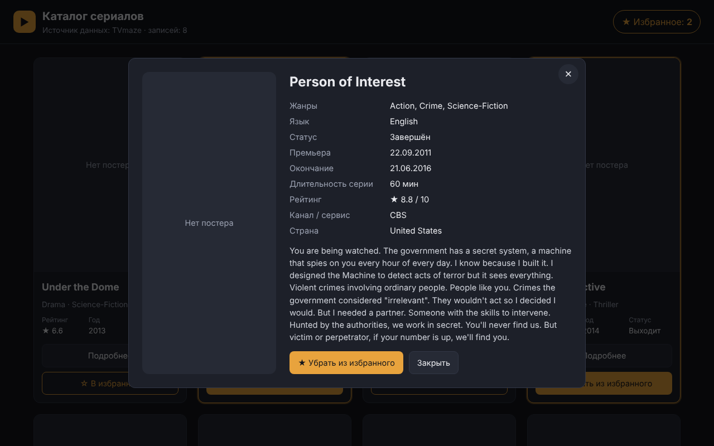
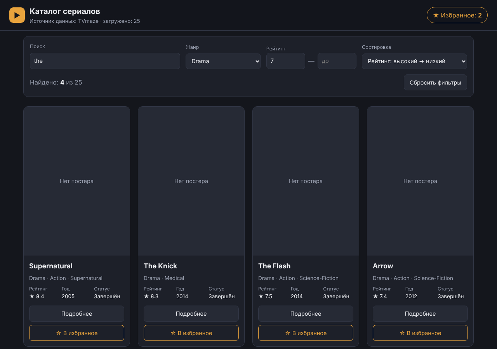
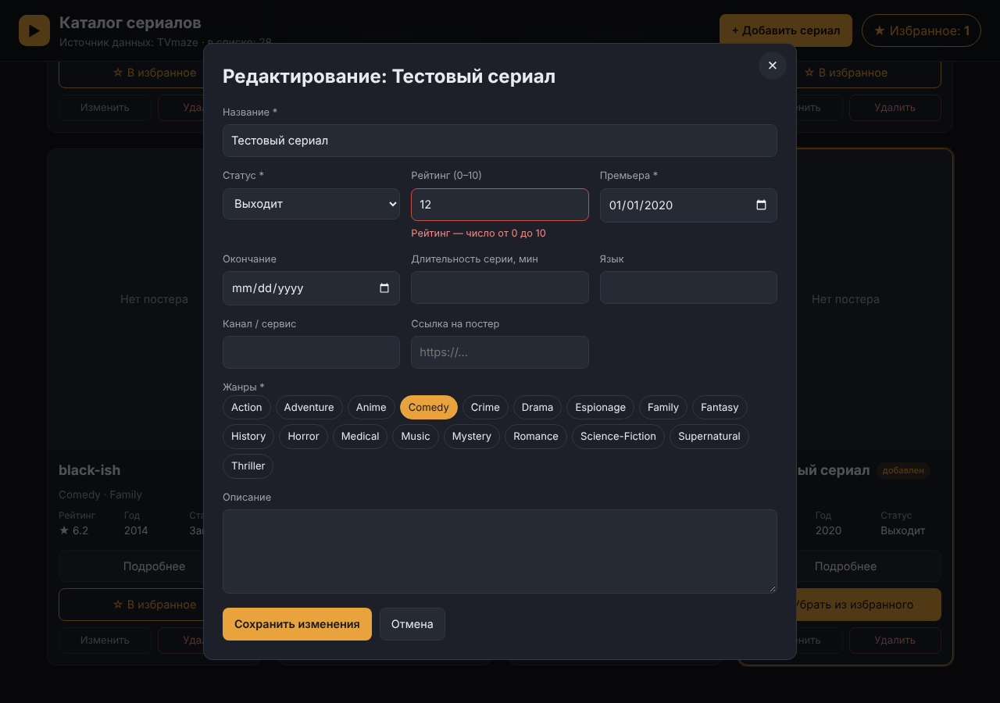
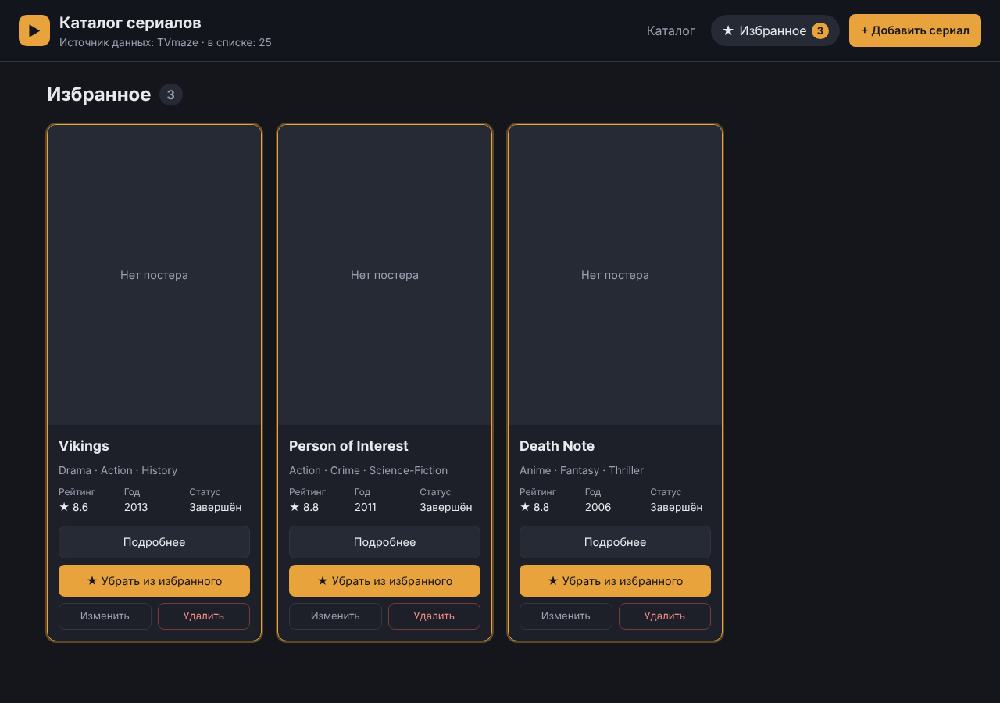

# Каталог сериалов (React + Vite)

Проектная работа по дисциплине «Dezvoltarea aplicațiilor web cu React».
Студент: Spataru Evghenii, группа IAFR2403 Ru.

**Назначение.** SPA для просмотра коллекции телесериалов из открытого API TVmaze: поиск, фильтры и сортировка, страница подробностей, локальное добавление/редактирование/удаление записей, избранное с сохранением между перезагрузками.

Четыре лабораторные работы — этапы одного приложения (коммиты и теги `lab-1` … `lab-4`).

## Запуск

Требуется Node.js 22.22+ (минимальная версия для React Router 8).

```bash
npm install
npm run dev
```

Открыть адрес, который выведет Vite (обычно http://localhost:5173).
Сборка: `npm run build`, просмотр сборки: `npm run preview`. Проверка кода: `npm run lint`.

## API

- **TVmaze** — https://api.tvmaze.com/shows?page=0 (публичный, без ключа, CORS разрешён). Ответ — массив сериалов, на странице 0 — 240 записей.
- Документация: https://www.tvmaze.com/api
- Данные API только читаются (GET). Ответ приводится к модели приложения функцией `normalizeShow()`.

### Поля сущности «сериал»

| Поле | Поле в API TVmaze | Назначение |
|---|---|---|
| `id` | `id` | уникальный идентификатор (key, CRUD, маршрут `/entity/:id`) |
| `name` | `name` | название; **поиск** |
| `genres` | `genres` | жанры; **категориальный фильтр** |
| `rating` | `rating.average` | рейтинг; **фильтр-диапазон** и **сортировка** |
| `premiered` | `premiered` | дата премьеры; **сортировка** |
| `network` | `network.name` / `webChannel.name` | канал или сервис; **поиск** |
| `status` | `status` | статус (выходит / завершён / …) |
| `ended` | `ended` | дата окончания |
| `language` | `language` | язык |
| `runtime` | `runtime` | длительность серии, мин |
| `country` | `network.country.name` | страна |
| `image` | `image.medium` | постер (если нет — placeholder) |
| `summary` | `summary` (HTML → текст) | описание |

### Поиск, фильтры и сортировка

- **Поиск:** по названию и каналу/сервису, без учёта регистра, срабатывает при вводе.
- **Категориальный фильтр:** жанр; список жанров строится из загруженных данных.
- **Фильтр-диапазон:** рейтинг от/до (0–10). Сериалы без рейтинга при заданном диапазоне скрываются; если «от» больше «до», показывается предупреждение.
- **Сортировка:** рейтинг ↓/↑ (по умолчанию — высокий → низкий), дата премьеры ↓/↑, название А→Я / Я→А. Записи без значения — в конце.
- Все условия работают одновременно, результат считается в `useMemo`. «Найдено: N из M», «Ничего не найдено», «Сбросить фильтры».

## Страницы

| Маршрут | Страница |
|---|---|
| `/` | Каталог: панель поиска/фильтров/сортировки и карточки |
| `/entity/:id` | Подробности сериала (избранное, изменить, удалить) |
| `/create` | Добавление сериала (форма с валидацией) |
| `/edit/:id` | Редактирование сериала |
| `/favorites` | Избранное |
| `*` | Страница 404 |

## Что выполняется локально и что восстанавливается после перезагрузки

- **Добавление, редактирование и удаление** сериалов выполняются **локально** — в состоянии приложения (`useReducer` в `useEntities`). На сервер TVmaze ничего не отправляется.
- После **перезагрузки страницы** список снова загружается из API: добавленные записи исчезают, изменённые и удалённые возвращаются к данным сервера.
- **Избранное** (массив ID) сохраняется в `localStorage` и **восстанавливается** после перезагрузки. Если в избранном была локально добавленная запись, после перезагрузки её уже нет — такой ID автоматически убирается из избранного.
- Фильтры каталога сохраняются при переходах между страницами, но не между перезагрузками.

## Этап 1 — компоненты, JSX, props, useState

- Локальный массив из 8 сериалов (`src/data/shows.js`, реальные данные TVmaze).
- Компоненты: `Header`, `ShowList`, `ShowCard`, `ShowDetailsModal`, а также `PosterImage` и `FavoriteButton`.
- Карточка: постер/placeholder, название, жанры, рейтинг, год, статус.
- «Подробнее» открывает модальное окно с расширенными сведениями; закрытие — кнопкой или кликом по фону (в этапе 4 заменено страницей `/entity/:id`).
- Избранное: массив ID в `App` (`useState`), переключение через props; счётчик в `Header`; повторное нажатие снимает отметку, один сериал не учитывается дважды.

## Этап 2 — useEffect, Fetch API, useMemo

- Загрузка `fetch()` внутри `useEffect` (async/await), проверка `response.ok`, отмена через `AbortController` в cleanup.
- Состояния: загрузка (индикатор), ошибка (текст + «Повторить»), пустой результат («Ничего не найдено»).
- Ответ API приводится к модели функцией `normalizeShow()` (HTML в описании → текст, `rating.average` → `rating`, `network`/`webChannel` → `network`).
- Список выводится через `map()` с `key={show.id}`.
- Поиск, жанр, диапазон рейтинга и сортировка работают одновременно; результат считается в `useMemo` с зависимостями `[shows, search, genre, minRating, maxRating, sortMode]`; `sort()` вызывается на новом массиве после `filter()`, исходный не мутируется.
- «Найдено: N из M», «Сбросить фильтры» (возвращает все параметры по умолчанию).
- Избранное хранится как массив ID отдельно от отфильтрованного списка — фильтры его не сбрасывают; окно деталей работает как раньше.

## Этап 3 — формы, useReducer, custom hook

- `logic/entitiesReducer.js` — чистый reducer. Состояние `{ entities, loading, error }`, действия `LOAD_START`, `LOAD_SUCCESS`, `LOAD_ERROR`, `ADD_ENTITY`, `UPDATE_ENTITY`, `REMOVE_ENTITY`. Все действия возвращают новые массивы и объекты (`[...]`, `map`, `filter`, `{ ...entity, ...changes }`), без `push` и изменения исходных данных; в reducer нет `fetch` и других побочных эффектов.
- `hooks/useEntities.js` — `useReducer` + `useEffect` + `fetch` + отмена через `AbortController`. Возвращает `entities, loading, error, addEntity(entity), updateEntity(id, changes), removeEntity(id)`, а также `reloadEntities()` и `getById(id)`. Компоненты не знают о `dispatch`.
- `components/ShowForm.jsx` — одна форма для создания и редактирования. Поля управляются через `useState`, при отправке — `preventDefault()` и проверка (`logic/showForm.js`):
  - обязательные: название, хотя бы один жанр, дата премьеры, статус;
  - рейтинг — число 0–10, длительность — целое 1–600, даты — корректные (1900–2100);
  - диапазон дат: окончание не раньше премьеры; дата окончания обязательна для статуса «Завершён» и не указывается для остальных;
  - ссылка на постер — `http(s)://…`.
- Создание: ID — `crypto.randomUUID()`, запись сразу появляется в списке (с отметкой «добавлен»).
- Редактирование: форма открывается с данными записи; после сохранения меняется только эта запись. (В этапе 3 форма была в модальном окне, в этапе 4 — на страницах `/create` и `/edit/:id`.)
- Удаление: кнопка «Удалить» с подтверждением; карточка исчезает без перезагрузки, запись убирается и из избранного.
- Поиск, фильтры и сортировка (`useMemo`) пересчитываются по актуальному массиву после любой операции.
- **Изменения локальные:** API TVmaze только читается, после перезагрузки страницы список снова загружается с сервера и локальные изменения сбрасываются (на этом этапе так и задумано).

## Этап 4 — Context API, localStorage, React Router

- `context/EntitiesContext.jsx` — `EntitiesProvider` вызывает `useEntities()` **один раз** и отдаёт всем страницам единое состояние и действия; доступ — через хук `useEntitiesContext()` (`context/useEntitiesContext.js`). Повторных независимых вызовов `useEntities()` в компонентах нет, поэтому API загружается один раз и CRUD с любой страницы виден везде.
- В Provider также хранятся избранное и фильтры каталога — фильтры сохраняются при переходах между страницами.
- Избранное сохраняется в `localStorage` (ключ `tv-catalog:favoriteIds`, `JSON.stringify`) и восстанавливается при запуске (`JSON.parse`). Чтение безопасное: битый JSON, не-массив или неверные значения дают пустой список / отбрасываются, приложение не падает.
- React Router (`BrowserRouter`, `Routes`, `Route`, `Link`, `NavLink`, `Outlet`), переходы без перезагрузки страницы; в деталях и редактировании ID берётся из `useParams()`, после сохранения формы — переход через `useNavigate()`.
- Общая шапка с навигацией — `components/Layout.jsx` + `Header.jsx` (счётчик избранного в пункте меню).
- Отсутствующая запись (`/entity/nonexistent`, `/edit/<неверный id>`) — понятное сообщение и ссылка в каталог; неизвестный адрес — страница 404; пустое избранное — отдельное сообщение.

## Структура

```
src/
  main.jsx                   — BrowserRouter + EntitiesProvider
  App.jsx                    — маршруты (Routes / Route)
  index.css
  api/showsApi.js            — fetchShows(): запрос к TVmaze, проверка ответа
  context/
    EntitiesContext.jsx      — EntitiesProvider: один вызов useEntities(), избранное, фильтры
    useEntitiesContext.js    — хук доступа к контексту (useContext)
    entitiesContextObject.js — объект контекста (createContext)
  hooks/
    useEntities.js           — загрузка + локальный CRUD (useReducer, useEffect, fetch)
    useDeleteShow.js         — удаление с подтверждением
  pages/
    CatalogPage.jsx          — каталог, фильтры, useMemo
    DetailsPage.jsx          — /entity/:id
    ShowFormPage.jsx         — /create и /edit/:id
    FavoritesPage.jsx        — /favorites
    NotFoundPage.jsx         — 404
  components/
    Layout.jsx, Header.jsx   — общая шапка и навигация (NavLink)
    FilterPanel.jsx          — поиск, жанр, рейтинг, сортировка, сброс
    ShowList.jsx, ShowCard.jsx
    ShowForm.jsx             — форма создания/редактирования с валидацией
    DataGate.jsx             — загрузка / ошибка перед содержимым страницы
    StatusMessage.jsx, NotFoundMessage.jsx, PosterImage.jsx, FavoriteButton.jsx
  logic/
    entitiesReducer.js       — чистый reducer (LOAD_*, ADD/UPDATE/REMOVE_ENTITY)
    normalizeShow.js         — объект API → модель приложения
    showFilters.js           — matchesSearch, matchesGenre, matchesRatingRange, compareShows
    showForm.js              — значения формы, валидация, преобразование в запись
    favoritesStorage.js      — чтение/запись избранного в localStorage
    formatShow.js            — форматирование полей
```

## Скриншоты

| Этап | Скриншот |
|---|---|
| lab-1 — карточки, окно деталей, избранное |  |
| lab-2 — данные из API, поиск, фильтры, сортировка |  |
| lab-3 — форма с валидацией, локальный CRUD |  |
| lab-4 — страницы, Context, избранное в localStorage |  |

## Источник данных

Данные о сериалах предоставлены [TVmaze](https://www.tvmaze.com/) (лицензия CC BY-SA).
